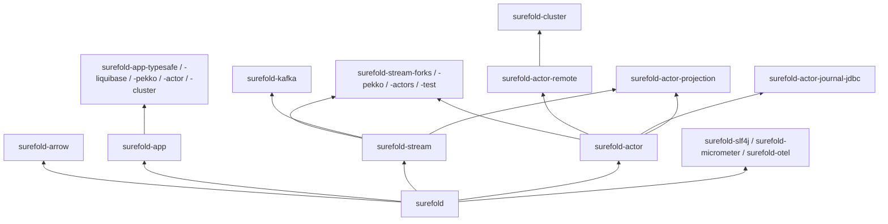

# Surefold

[](https://central.sonatype.com/artifact/io.github.matthewjones372/surefold)
[](https://github.com/matthewjones372/lark/actions/workflows/build.yml)
[](AGENTS.md#verifying)
[](https://kotlinlang.org)
[](https://openjdk.org/projects/jdk/25/)
[](LICENSE)
[](#status)

Surefold is a set of Kotlin libraries for writing services on the JDK's virtual
threads, with ordinary blocking code and no coroutines. Its core gives you
structured concurrency, resource safety, retries and timeouts, with typed
errors in Surefold's own `Fail` and `Either`. Further modules build on that core:
an application wired as a checked dependency graph, typed streams, actors,
persistence, clustering, Kafka, and integrations for logging, metrics and
tracing.

Each module is a separate dependency. You can use the core on its own, or add
only the pieces a service needs.

Surefold is experimental. It is published so that it is easy to try, but its API
changes between releases. See [Status](#status).

Surefold was published as Lark up to 0.11.0, under `io.github.matthewjones372:lark*` and the
package `io.github.matthewjones372.lark`. Moving over is a rename: `lark` becomes `surefold` in
every artifact, package, plugin id and configuration key.

## Why virtual threads

Since JDK 21, a blocked virtual thread parks without holding an OS thread, so
a service can block on JDBC, a file or an HTTP client with no async API and
still serve many requests at once. Writing that code as plain functions avoids
`suspend` and a second calling convention, and stack traces, debuggers and
profilers see ordinary threads.

What virtual threads do not give you is structure. `Thread.ofVirtual().start`
does not know which request started it, does not stop when a sibling fails,
and carries no context. Surefold adds:

- **Structured concurrency.** Forks belong to a scope. A scope returns only
  after every fork it started has ended, and the first failure interrupts the
  rest.
- **Typed errors across forks.** A branch can `fail` with a declared error,
  and the combinator returns it as the scope's `Left`. A failure never
  crosses a thread on its own, and `catch (e: Exception)` cannot swallow it.
- **Resources and policies.** Acquire and release in reverse order on every
  exit path, and retry, time out, break or limit calls with composable values.
- **Shared state without locks.** `transact { }` changes several `Shared`
  values as one step, waits until the state allows it, and never deadlocks.
- **Context that crosses forks.** Log annotations, metric tags, trace context
  and the clock are inherited by every fork, so a correlation id or a test
  clock reaches the branches of a `parMap`.

The core depends on the JDK and the Kotlin standard library, and nothing
else. Its combinators have the same names and shapes as
`arrow-fx-coroutines`, so moving a function across usually means removing
`suspend`, writing `attempt` for `either` and `fail` for `raise`, and changing
an import. [Coming from Arrow](docs/arrow.md) has the rest, and
`surefold-arrow` converts between the two for code that keeps both.

## A first look

Two blocking lookups run at the same time on virtual threads, inside a
time limit, with a typed error:

```kotlin
fun summary(id: UserId): Either<SummaryError, Summary> = attempt {
    timeout(2.seconds) {
        parZip(
            { users.find(id) ?: fail(UserNotFound(id)) },    // blocking JDBC call
            { orders.recent(id) },                          // blocking HTTP call
        ) { user, recent -> Summary(user, recent) }
    }
}
```

If the user is missing, that branch fails, the orders call is interrupted,
and `summary` returns `Left(UserNotFound(id))`. If either call throws, the
other is interrupted and the exception propagates. If two seconds pass,
both are interrupted and `timeout` throws `TimeoutException`. In every case
`summary` returns only after both forks have ended, so no work is left
running behind it.

## What you can build

**Concurrent, resource-safe code.** [`surefold`](docs/core.md) provides `parZip`,
`parMap`, `raceN`, `scope { async { } }`, `resourceScope`, `Schedule`,
`timeout`, `policy`, which combines a deadline, retries, a circuit breaker,
a rate limiter and a bulkhead, and `transact` over `Shared` values. `surefold-pekko` lets those forks run on a Pekko
dispatcher.

**An application as a dependency graph.** [`surefold-app`](docs/app.md) describes
a service as a value: each node says what it builds and what it needs. The
graph is checked before anything is constructed, started in dependency order
with independent nodes in parallel, waits for readiness probes, and is released
in reverse order on shutdown. Tests can start a subgraph with fakes. A Gradle
plugin and a K2 compiler plugin report a broken graph at build time and in the
editor. Integrations make HOCON configuration, Liquibase migrations, Pekko
actors and Surefold actors into nodes.

**Typed streams.** [`surefold-stream`](docs/stream.md) is `Stream<E, A>`, a
pipeline whose declared failure is part of its type. A stream is a description,
and you choose where it runs: a pull loop on a virtual thread, Pekko Streams,
Surefold actors, or a test backend with a clock the test controls.

**Actors, persistence and clusters.** [`surefold-actor`](docs/actors.md) runs
actors on virtual threads within a `scope`, with supervision, timers, routers,
event-sourced persistence and a deterministic test runtime.
[Remote and cluster modules](docs/cluster.md) add TCP messaging with optional
mutual TLS, gossip membership, sharded entities, singletons, reliable delivery,
topics, a JDBC journal and read-model projections.

**Kafka.** [`surefold-kafka`](docs/kafka.md) reads a topic as a `Stream` on any
backend. Offsets are committed only after the work on a record is done, and
transactions give exactly-once output to `read_committed` readers, with
one caveat at the end of a run that the guide describes.

**Observability.** Logging, metrics and tracing calls are part of the core and
cross forks. Adding [`surefold-slf4j`, `surefold-micrometer` or `surefold-otel`](docs/observability.md)
sends them to the backend a service already uses.

**Tests that do not wait.** [Testing utilities](docs/testing.md) include
`TestClock`, `story { Given / When / Then }`, `eventually`, `testApp` for a
subgraph, actor tests that step on the calling thread, and a stream backend
on a test clock. [`surefold-junit`](#tests-that-run-together) runs a suite's tests
concurrently on virtual threads, shares one resource across them, and reports
to Gradle, the IDE and CI as JUnit does.

### How the pieces fit



An arrow points from a module to the modules that build on it. Everything runs
on virtual threads from the JDK; no module starts an event loop or a
coroutine dispatcher.

## Modules

Each module sits in its family's folder: `core/`, `stream/`, `actor/`, `cluster/`, `app/`,
`integrations/`, with the benchmarks in `bench/` and an example service in `examples/`.

The main modules, all under the group `io.github.matthewjones372`. The
[module guide](docs/modules.md) lists every module, what each one adds to
your classpath, and which are unpublished.

| Module | Use it for | Adds |
|---|---|---|
| `surefold` | forks, errors, resources, schedules, policies, shared state, context, logs and metrics ([guide](docs/core.md)) | nothing |
| `surefold-arrow` | Surefold's `Either`, `NonEmptyList` and `Fail` to and from Arrow's ([guide](docs/arrow.md)) | `arrow-core` |
| `surefold-app` | an application as a checked dependency graph ([guide](docs/app.md)) | nothing |
| `surefold-stream` | `Stream<E, A>` as a description ([guide](docs/stream.md)) | nothing |
| `surefold-stream-forks` | the stream backend on a virtual thread | nothing |
| `surefold-stream-pekko` | the stream backend on Pekko Streams | `pekko-stream` |
| `surefold-actor` | actors, supervision, persistence and actor tests ([guide](docs/actors.md)) | nothing |
| `surefold-actor-remote` | actors across nodes over TCP ([guide](docs/cluster.md)) | nothing |
| `surefold-actor-journal-jdbc` | the event journal, snapshots and offsets on JDBC ([guide](docs/cluster.md)) | nothing |
| `surefold-cluster` | membership, sharding, singletons, reliable delivery, topics ([guide](docs/cluster.md)) | nothing |
| `surefold-kafka` | Kafka as a `Stream`, producers and transactions ([guide](docs/kafka.md)) | `kafka-clients` |
| `surefold-slf4j`, `surefold-micrometer`, `surefold-otel` | logs, metrics and traces to an existing backend ([guide](docs/observability.md)) | the library named |
| `surefold-test` | `story` and `eventually` for service tests ([guide](docs/testing.md)) | nothing |
| `surefold-junit` | suites whose tests run together, expectations as values, aspects ([guide](docs/testing.md#suites)) | `junit-platform-engine` |

"Adds" is the external dependency a module brings beyond the Surefold modules it
builds on. Each module has a `NoOtherDependenciesTest` that checks its runtime
classpath against that list, so a new transitive dependency fails the build.

## Status

Surefold is an experiment in what a Kotlin service looks like without coroutines.
Everything described in these guides is implemented and tested, and the build
enforces 90% line coverage. That said:

- **The API is not stable.** Releases are `0.x`, and any release can change or
  remove API. There is no binary-compatibility check. Pin an exact version.
- **No production use is known.** Apart from its tests, the code is exercised by
  [`surefold-bank`](docs/modules.md#the-example-application), an example
  application in this repository, and by the related projects listed below.
- **Maturity varies.** The core, `surefold-app` and `surefold-stream` are the most
  established. The actor, cluster and Kafka modules are newer.
- **Some numbers are provisional.** Benchmark results were measured on JDK 21
  on a shared cloud machine, and the cluster benchmarks have not been run yet.

These guides describe the `main` branch. A few features documented here are
newer than the latest release; they are marked where they appear.

## Try it

Surefold needs **JDK 25 or newer** at runtime and is built with **Kotlin 2.4.10**.
JDK 25 is required because earlier JDKs pin a virtual thread's carrier while
it blocks inside `synchronized`, which can exhaust the carriers when a library
such as a JDBC driver or JSON serializer synchronizes internally. JDK 24 removed
that limitation ([JEP 491](https://openjdk.org/jeps/491)), and 25 is the first
long-term-support release with the fix.

```kotlin
// build.gradle.kts
kotlin { jvmToolchain(25) }

dependencies {
    // brings nothing but the Kotlin standard library
    implementation("io.github.matthewjones372:surefold:0.13.0")
}
```

A complete program, with every import it uses:

<!-- quickstart-example -->
```kotlin
import io.github.matthewjones372.surefold.fail.Either
import io.github.matthewjones372.surefold.fail.attempt
import io.github.matthewjones372.surefold.parZip
import io.github.matthewjones372.surefold.timeout
import kotlin.time.Duration.Companion.seconds

data class User(val id: Int, val name: String)

data class Order(val id: Int, val pence: Long)

data class Summary(val user: User, val orders: List<Order>)

data class UserNotFound(val id: Int)

// Stand-ins for a database and an HTTP client: each one blocks its thread.
fun findUser(id: Int): User? {
    Thread.sleep(100)
    return if (id == 1) User(1, "Ada") else null
}

fun recentOrders(id: Int): List<Order> {
    Thread.sleep(100)
    return listOf(Order(7, 1200))
}

fun summary(id: Int): Either<UserNotFound, Summary> = attempt {
    timeout(2.seconds) {
        parZip(
            { findUser(id) ?: fail(UserNotFound(id)) },
            { recentOrders(id) },
        ) { user, orders -> Summary(user, orders) }
    }
}

fun main() {
    println(summary(1)) // Right(value=Summary(user=User(id=1, name=Ada), orders=[Order(id=7, pence=1200)]))
    println(summary(2)) // Left(value=UserNotFound(id=2))
}
```

The two lookups run at the same time, so `summary(1)` takes about 100 ms rather
than 200.

Every published module uses the same group and version, so adding another is
one more line, for example
`implementation("io.github.matthewjones372:surefold-app:0.13.0")`. The
[module guide](docs/modules.md) has the coordinates, what each module brings,
and how to use a snapshot or a local build.

## Tests that run together

`surefold-junit` is optional. Surefold is a library, so a plain JUnit Jupiter test can
call it directly, with `TestClock`, `capturingLogs`, `story`, `eventually` and
`surefold-assert`'s matchers, and nothing here needs changing.

`surefold-junit` is for the suites where Jupiter gets in the way:

- **Speed.** A suite's tests run concurrently, each on its own virtual thread,
  under a `Limit` you choose for that suite. Jupiter's parallel mode is one
  global switch over a pool of platform threads.
- **One expensive resource, shared safely.** A database or a cluster is a
  `Resource`, acquired once, handed to every test, and released in reverse
  order. If acquiring it fails, each test fails with the cause. In Jupiter it
  is a `lateinit` static set in `@BeforeAll` and cleaned up by hand.
- **Isolation.** The clock, logger and metrics are bound for each test, so
  concurrent tests can't see each other's. In Jupiter they are process-wide.
- **Output you can read.** A test's logs are printed only if it fails.
  Every failed check is reported, not just the first, and a failed `expect`
  shows the value of each part of the expression.
- **Tests that can't check nothing.** A test returns its checks as a value, so
  one with no checks doesn't compile.
- **Aspects.** `flaky`, `nonFlaky`, `timeout`, `tag` and `ignore` are values
  you combine with `+`. `nonFlaky(50)` proves that a load-sensitive test is
  stable.

Stay on Jupiter for tests that need its extensions, such as parameterized
tests, `@TempDir`, or a framework's own extension. The two engines run side by
side in one `test` task.

Because `surefold-junit` is a JUnit Platform engine, its suites run beside JUnit
Jupiter tests in the same `test` task, and Gradle's XML reports, the IDE and CI
read the results unchanged.

```kotlin
// build.gradle.kts
dependencies {
    testImplementation("io.github.matthewjones372:surefold-junit:0.13.0")
}

tasks.test { useJUnitPlatform() }
```

A suite is an `object`. It acquires its `shared` resource once and hands it to
every test, and its tests run concurrently, each on its own virtual thread,
under the suite's `Limit`. A test returns what its checks found as a value, so
a test that checks nothing does not compile, and every failed check is
reported rather than only the first. A test's logs are printed only if it
fails.

<!-- readme-junit-suite -->
```kotlin
import io.github.matthewjones372.surefold.Limit
import io.github.matthewjones372.surefold.Resource
import io.github.matthewjones372.surefold.junit.SharedSuite
import io.github.matthewjones372.surefold.junit.expect
import io.github.matthewjones372.surefold.junit.flaky
import io.github.matthewjones372.surefold.junit.shouldBe
import io.github.matthewjones372.surefold.junit.tag
import io.github.matthewjones372.surefold.resource
import java.util.concurrent.ConcurrentHashMap

// Stands in for a database: started once for the suite, closed after its last test.
class Inventory {
    private val stock = ConcurrentHashMap<String, Int>()

    fun add(item: String, count: Int) {
        stock.merge(item, count, Int::plus)
    }

    fun count(item: String): Int = stock[item] ?: 0

    fun close() = stock.clear()
}

object InventorySuite : SharedSuite<Inventory>(limit = Limit.fixed(8), aspects = tag("db")) {
    override val shared: Resource<Inventory> = resource { install({ Inventory() }) { db, _ -> db.close() } }

    init {
        test("stock adds up") { db ->
            db.add("apples", 2)
            db.add("apples", 3)
            db.count("apples") shouldBe 5
            expect(db.count("pears") == 0)
        }
        test("a missing item has none", flaky(3)) { db -> db.count("plums") shouldBe 0 }
    }
}
```

With Kotlin's power-assert plugin applied to the test source set, a failed
`expect` draws the value of each part of its expression; a failed `shouldBe`
carries expected and actual, so IntelliJ opens its diff. Each check counts as
it is made, so a test is its checks written one after another. The
[testing guide](docs/testing.md#suites) covers the shared resource, running a
test alone, the diagram, and aspects such as `flaky`, `nonFlaky`, `timeout`,
`tag` and `ignore`.

## Where next

**Evaluating Surefold**

- [Core concurrency, errors and resources](docs/core.md): what the forks,
  cancellation and resource guarantees are, in detail.
- [Applications](docs/app.md): the dependency graph and the build-time checks.
- [Modules](docs/modules.md): what to depend on, what each module brings,
  maturity, performance and limitations.
- [`surefold-bank`](docs/modules.md#the-example-application): three nodes of a
  small bank, using actors, persistence, remoting and clustering together.

**Using a capability**

- [Core](docs/core.md): `parZip`, `scope`, cancellation, `resourceScope`,
  `Schedule`, `timeout`, `policy`, `SurefoldLocal` and the clock, and Pekko
  dispatchers.
- [Applications](docs/app.md) and the [application cookbook](docs/cookbook.md),
  one compiled recipe per task: wiring, lifecycle, configuration, probes,
  migrations, actors and testing.
- [Streams](docs/stream.md): `Stream<E, A>`, the operators and the backends.
- [Actors](docs/actors.md): behaviours, supervision, timers, routing,
  persistence and testing on one node.
- [Remoting and clusters](docs/cluster.md): nodes, membership, sharding, a
  shared journal, read models, reliable delivery and topics.
- [Kafka](docs/kafka.md): consuming, committing, producing and transactions.
- [Observability](docs/observability.md): logs, metrics and traces.
- [Testing](docs/testing.md): the test utilities in one place, and
  `surefold-junit` suites.
- [Feature flags](docs/flags.md): OpenFeature flags declared once, and read
  for the request in every fork and actor.

**Writing code with an agent.** [`llms.txt`](llms.txt) summarises what Surefold
ships and which call to use for a task. In Claude Code, the Surefold plugin loads
the same guidance whenever code uses Surefold:

```
/plugin marketplace add matthewjones372/lark
/plugin install surefold@surefold
```

**Contributing.** [`AGENTS.md`](AGENTS.md) describes how work on this
repository is done: a spec in [`specs/`](specs/README.md) first, small stacked
pull requests, and the gates that `./gradlew build` enforces. Building needs
JDK 25 (and JDK 27 for the unpublished `surefold-structured` module); Gradle's
toolchain support can download them.

```bash
./gradlew spotlessApply && ./gradlew build
```

## Related projects

- [Proofload](https://github.com/matthewjones372/proofload): load testing on
  virtual threads.
- [Pelican](https://github.com/matthewjones372/pelican): HTTP endpoints as
  values, served on Pekko HTTP.
- [kimney](https://github.com/matthewjones372/kimney): compile-time mapping
  between Kotlin types.
- [petshop](https://github.com/matthewjones372/petshop): a small service that
  uses Surefold with Pelican and Proofload.
- [surefold-bank](https://github.com/matthewjones372/surefold-bank): a bank in
  four services on a three-node Surefold cluster, with its journal in Postgres and
  its events on Kafka.

## Credit

Surefold owes its error model and the shape of its combinators to
[Arrow](https://arrow-kt.io). `Either`, `NonEmptyList` and `Fail` follow the
types Arrow made familiar in Kotlin, and `parZip`, `parMap`, `raceN` and their
`OrAccumulate` forms keep the names and shapes of `arrow-fx-coroutines`, so code
moves between the two with little change. Surefold's versions are written from
scratch for blocking code on virtual threads rather than taken from Arrow.
Anyone already using Arrow can keep it alongside: [`surefold-arrow`](docs/arrow.md)
converts between the two.

## Licence

Apache 2.0.
