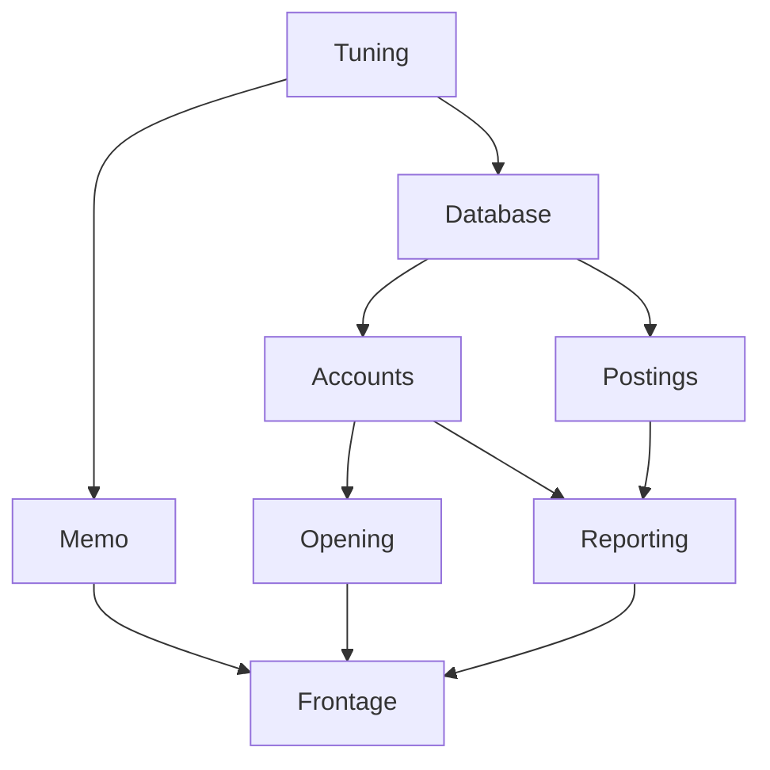

# Application cookbook

Recipes for [`surefold-app`](app.md), in roughly the order a service needs them.
Each Kotlin fence marked for it is compiled by `CookbookTest`, together with
the fixtures below, so a recipe that stops matching the library fails the
build. Of the configuration fences only the class form is compiled, and the
`surefold-app-liquibase` fences are not, because that module is not on its
classpath.

[Applications](app.md) explains how the graph behaves; this page shows how to
write each piece.

```kotlin
dependencies {
    implementation("io.github.matthewjones372:surefold-app:0.14.0")
    implementation("io.github.matthewjones372:surefold-app-pekko:0.14.0")  // Pekko actors only
}
```

The types the recipes are written against:

<!-- cookbook-fixtures -->
```kotlin
import com.typesafe.config.Config
import com.typesafe.config.ConfigFactory
import io.github.matthewjones372.surefold.ExitCase
import io.github.matthewjones372.surefold.app.HealthRegistry
import io.github.matthewjones372.surefold.app.Module
import io.github.matthewjones372.surefold.app.RealSys
import io.github.matthewjones372.surefold.app.SurefoldApp
import io.github.matthewjones372.surefold.app.Sys
import io.github.matthewjones372.surefold.app.boundTo
import io.github.matthewjones372.surefold.app.closingOf
import io.github.matthewjones372.surefold.app.findings
import io.github.matthewjones372.surefold.app.kotlinx.Naming
import io.github.matthewjones372.surefold.app.kotlinx.Secret
import io.github.matthewjones372.surefold.app.kotlinx.config
import io.github.matthewjones372.surefold.app.overriding
import io.github.matthewjones372.surefold.app.pekko.actor
import io.github.matthewjones372.surefold.app.probe
import io.github.matthewjones372.surefold.app.render
import io.github.matthewjones372.surefold.app.report
import io.github.matthewjones372.surefold.app.runApp
import io.github.matthewjones372.surefold.app.single
import io.github.matthewjones372.surefold.app.singleOf
import io.github.matthewjones372.surefold.app.subgraph
import io.github.matthewjones372.surefold.app.testApp
import io.github.matthewjones372.surefold.app.validate
import kotlinx.serialization.Serializable
import org.apache.pekko.actor.ActorSystem
import org.apache.pekko.actor.typed.ActorRef
import org.apache.pekko.actor.typed.Behavior
import org.apache.pekko.actor.typed.javadsl.Behaviors
import kotlin.system.exitProcess
import kotlin.time.Duration
import kotlin.time.Duration.Companion.milliseconds
import kotlin.time.Duration.Companion.seconds

data class DbConfig(val url: String)
data class HttpConfig(val port: Int)
data class AppConfig(val db: DbConfig, val http: HttpConfig)

interface Pool { fun healthy(): Boolean }
class Hikari(val config: DbConfig) : Pool, AutoCloseable {
    override fun healthy() = true
    override fun close() = Unit
}

interface UserRepo { fun find(id: Long): String? }
class PgUserRepo(private val pool: Pool) : UserRepo {
    override fun find(id: Long) = "user-$id"
}

class RegisterUser(private val users: UserRepo) {
    fun register(id: Long): String? = users.find(id)
}

class HttpServer(private val config: HttpConfig, private val register: RegisterUser) {
    fun start() = Unit
    fun stop() = Unit
}
```

## A constructor is a node

A constructor reference already declares what it builds and what it needs, so
`singleOf` reads both from it:

<!-- cookbook -->
```kotlin
class PgUsers(private val pool: Pool)

val fromConstructors: Module = singleOf(::Hikari).boundTo<Pool>() + singleOf(::PgUsers)
```

`boundTo` keys the node as the interface its dependents ask for. With
`singleOf` you never write a type argument beside a dependency.

A node that is `AutoCloseable` is closed on release by `closingOf`, in reverse
dependency order:

<!-- cookbook -->
```kotlin
val heldThings: Module = closingOf(::Hikari).boundTo<Pool>()
```

A release with another name, such as `stop` or `shutdown`, goes beside the
constructor:

<!-- cookbook -->
```kotlin
val served: Module = singleOf(::HttpServer, HttpServer::stop)
```

## What a `single` is

`single` is one node written as a lambda: how to build one value, and what it
needs.

<!-- cookbook -->
```kotlin
val aPool: Module = single { db: DbConfig -> Hikari(db) as Pool }
```

The types say three things:

- **The parameters are the dependencies.** This node needs a `DbConfig`, and
  is not built until something has provided one.
- **The return type is the key.** This node provides a `Pool`.
- **It is built once.** Ten nodes asking for a `Pool` share this one.

Without the graph, the same wiring is written by hand, which works until
ordering, sharing, closing and testing matter:

```kotlin
val db = DbConfig("jdbc:…")
val pool = Hikari(db)              // who closes it, and when?
val users = PgUserRepo(pool)       // and if two things need a pool, is it this one?
```

`plus` puts nodes together, in any order, because matching is by type:

<!-- cookbook -->
```kotlin
val twoNodes: Module = single { db: DbConfig -> Hikari(db) as Pool } +
    single<UserRepo, Pool> { pool -> PgUserRepo(pool) }
```

### A factory from Java

A Java method returns a platform type, so the key is inferred as `Tracer!` and
nothing asking for a `Tracer` matches it. The graph then reports `missing
Tracer` although a Tracer is in it. Name the key with `boundTo`:

<!-- cookbook -->
```kotlin
val fromJava: Module = single { pool: Pool -> pool.toString() }.boundTo<CharSequence>()
```

A type argument would also work, but Kotlin has no partial type-argument
inference, so `single<CharSequence, Pool> { … }` has to name `Pool` twice.
`boundTo` takes the key afterwards, so each type is written once.

A node with no dependencies writes its type argument, because a bare lambda
would also fit the one-dependency overload:

<!-- cookbook -->
```kotlin
val noDependencies: Module = single<Sys> { RealSys }
```

## Wire an application

<!-- cookbook -->
```kotlin
val config: Module =
    single<Sys> { RealSys } +
    single { sys: Sys ->
        AppConfig(
            DbConfig(sys.env("DB_URL") ?: refuse("DB_URL is not set")),
            HttpConfig(sys.env("PORT")?.toIntOrNull() ?: refuse("PORT is not a number")),
        )
    } +
    single { app: AppConfig -> app.db } +
    single { app: AppConfig -> app.http }

val persistence: Module =
    closingOf(::Hikari).boundTo<Pool>() +
    single<UserRepo, Pool> { pool -> PgUserRepo(pool) }

val domain: Module = single { users: UserRepo -> RegisterUser(users) }

val web: Module =
    single { http: HttpConfig, register: RegisterUser -> HttpServer(http, register) }

val app: Module = config + persistence + domain + web
```

`refuse` ends the start with a reason instead of an exception. `plus` is
override, so where two modules provide the same key, the right-hand node wins.

## Run it

An application declared as a `SurefoldApp` names the node it starts from, which
lets the build check it without running `main`:

<!-- cookbook -->
```kotlin
object TheApp : SurefoldApp<HttpServer>() {
    override val module: Module = app
}

fun main(): Unit = exitProcess(runApp(TheApp).code)
```

With no `run` of its own, `TheApp` parks until the process is asked to stop,
then releases the graph.

The same without a `SurefoldApp`, with the root's work written inline:

<!-- cookbook -->
```kotlin
fun mainInline() {
    exitProcess(
        runApp(app) { server: HttpServer ->
            server.start()
            awaitShutdown()
        }.code
    )
}
```

`runApp` answers with an `ExitCode` rather than ending the process, so a test
can run an application and read what it decided. The `exitProcess` is yours.
Independent nodes start on forks of their own, the first refusal interrupts
its siblings, and everything acquired is released in reverse dependency
order. A signal returns from `awaitShutdown`, and the shutdown hook waits for
the releases before the process leaves.

## Read the process itself

`Sys` is the process: what a node reads when it wants an environment variable
or a system property rather than a setting. A node calling `System.getenv`
directly is a node no test can configure.

<!-- cookbook -->
```kotlin
val fromTheProcess: Module =
    single<Sys> { RealSys } +
    single { sys: Sys -> DbConfig(sys.env("DB_URL") ?: refuse("DB_URL is not set")) }
```

`FakeSys(mapOf("DB_URL" to "jdbc:postgresql://db/app"))` replaces it in a test.

## Something that has to be given back

`install` inside a node gives a release that is told how the application
ended:

<!-- cookbook -->
```kotlin
val closing: Module = single { db: DbConfig ->
    install({ Hikari(db) }) { pool, exit ->
        if (exit is ExitCase.Failure) pool.close() else pool.close()
    } as Pool
}
```

## Two of the same type

One key, one instance. A second `Pool` needs a second key, and a value class
costs nothing:

<!-- cookbook -->
```kotlin
@JvmInline
value class Replica(val pool: Pool)

val replicated: Module =
    single { db: DbConfig -> Hikari(db) as Pool } +
    single { db: DbConfig -> Replica(Hikari(DbConfig(db.url + "-replica"))) } +
    single { primary: Pool, replica: Replica -> PgUserRepo(replica.pool) as UserRepo }
```

The type says which one a dependent wants, which a `named("replica")` string
would not.

## Bind an interface

<!-- cookbook -->
```kotlin
val boundToInterface: Module = single<UserRepo, Pool> { pool -> PgUserRepo(pool) }

val boundToTheClass: Module = single { pool: Pool -> PgUserRepo(pool) }
```

The first is keyed `UserRepo`, the second `PgUserRepo`. Bind to the interface
when a test will swap it.

## Something slow to start

Dependents wait for the probe, not the constructor:

<!-- cookbook -->
```kotlin
val probed: Module =
    closingOf(::Hikari).boundTo<Pool>()
        .probe("db", timeout = 2.seconds, attempts = 10, interval = 500.milliseconds) { pool: Pool ->
            pool.healthy()
        }
```

## Answer /ready and /live

`HealthRegistry` is provided by the running application, so a route takes it
as a dependency:

<!-- cookbook -->
```kotlin
class Routes(private val health: HealthRegistry) {
    fun ready() = health.readiness()
    fun live() = health.liveness()
}

val routed: Module = probed + single { health: HealthRegistry -> Routes(health) }
```

`critical = false` on a probe degrades readiness rather than downing it.

## Test the wiring, not one class

A test of one class calls its constructor, with its collaborators as
arguments. The graph never appears, so a wiring change cannot break it:

<!-- cookbook -->
```kotlin
class InMemoryUsers : UserRepo {
    override fun find(id: Long) = "fake-$id"
}

fun oneClass() = check(RegisterUser(InMemoryUsers()).register(1) == "fake-1")
```

The graph is for a claim that holds only with the nodes together: start and
release order, readiness, a fake replacing one node among real ones. Here the
real server and domain nodes run over a faked repository and a fixed port:

<!-- cookbook -->
```kotlin
fun theWiring() {
    val underTest = app
        .overriding(single<UserRepo> { InMemoryUsers() } + single<HttpConfig> { HttpConfig(port = 0) })
        .subgraph<HttpServer>()

    testApp(underTest) { server: HttpServer -> server.start() }
}
```

`overriding` refuses a key the graph does not already hold, so a fake cannot
sit beside the real node while the real one runs. `subgraph` then keeps only
what its root is reached through: with the repository and the port replaced,
that leaves out the pool and the environment. `testApp` releases the graph
however the block ends.

## Check the graph without running it

<!-- cookbook -->
```kotlin
fun theApplicationWires() = app.validate()

fun theWiringIsWhatWeThink(): String = app.render()

fun everyFault(): String = TheApp.module.findings(TheApp.root).report()
```

`findings` answers with every error and warning:

```
surefold-app wiring

❯ error: missing Pool
❯     for PgUserRepo         Wiring.kt:42

❯ warning: HttpConfig provided twice
❯     Config.kt:14           shadowed
❯     Local.kt:9             wins

❯ warning: nothing reaches Metrics          Telemetry.kt:9
```

Applying the `io.github.matthewjones372.surefold.wiring` Gradle plugin runs this on
every build and draws each graph; see
[Checking the graph in the build](app.md#checking-the-graph-in-the-build).

`render` draws Mermaid in a stable order, so the drawing can be reviewed. For
this graph:

```kotlin
val drawn: Module =
    single<Tuning> { Tuning() } +
        single { _: Tuning -> Database() } +
        single { _: Tuning -> Memo() } +
        single { _: Database -> Accounts() } +
        single { _: Database -> Postings() } +
        single { _: Accounts -> Opening() } +
        single { _: Accounts, _: Postings -> Reporting() } +
        single { _: Memo, _: Opening, _: Reporting -> Frontage() }
```

`drawn.render()` answers exactly this, which GitHub draws as a diagram (there
is also [a PNG](wiring.png) for viewers that do not render Mermaid):

<!-- cookbook-diagram -->


The diagram shows two things the code does not: `Database` and `Memo` have no
edge between them, so they start at the same time; and every path into
`Frontage` is something that must be ready before the service accepts
requests.

`WiringDiagramSuite` holds the fence above to what `render` answers, and
`DiagramImageSuite` holds the PNG to the fence. After changing the graph, run
`docs/render-diagram.sh` to redraw the PNG.

## Configuration a module owns

`surefold-app-typesafe` makes a HOCON section a node, read by the module that
needs it. `surefold-app-kotlinx` reads it from a `@Serializable` class, each
property a path named after it.

```kotlin
plugins {
    kotlin("plugin.serialization") version "2.4.10"
}

dependencies {
    implementation("io.github.matthewjones372:surefold-app-kotlinx:0.14.0")
}
```

<!-- cookbook -->
```kotlin
@Serializable
data class PoolSettings(val url: String, val poolSize: Int = 8, val idle: Duration, val password: Secret)

val pool: Module =
    single<Config> { ConfigFactory.load() } +
        config<PoolSettings>("database", Naming.Kebab) +
        closingOf { db: PoolSettings -> Hikari(DbConfig(db.url)) }.boundTo<Pool>()
```

A nested class is a nested section. A default or a nullable makes a key
optional, and an enum names its entries when the file says something else.
`Duration` reads `30s`; `Secret` reads a string that prints as the mask.
`Naming.Kebab` reads `poolSize` from `pool-size`, and `@SerialName` names one
key, itself kebab-cased under `Naming.Kebab` if it has capitals. Every fault is
named at once, as the block form names them.
`Secrets.default.andSecretsOf<PoolSettings>("database", Naming.Kebab)` masks
each `Secret` path in the report below, given the naming `config` was given;
and `config.choosing<Settings>(path) { settings -> … }`
reads the class the same way.

The block form says what a class cannot: a size in bytes, a value computed
from two keys, or anything else read from the `Config` directly. Nothing is
wrapped: `of` hands over the real `com.typesafe.config.Config`, so
substitution, merging, `getDuration` and `getMemorySize` all still work.

```kotlin
dependencies {
    implementation("io.github.matthewjones372:surefold-app-typesafe:0.14.0")
}
```

```kotlin
import com.typesafe.config.Config
import com.typesafe.config.ConfigFactory
import io.github.matthewjones372.surefold.app.typesafe.config

data class DbSettings(val url: String, val poolSize: Int, val idle: kotlin.time.Duration)

val database: Module =
    single<Config> { ConfigFactory.load() } +
    config<DbSettings>("database") { DbSettings(string("url"), int("poolSize"), duration("idle")) } +
    closingOf { db: DbSettings -> Hikari(DbConfig(db.url)) }.boundTo<Pool>()
```

The readers are `string`, `int`, `long`, `boolean`, `duration` (a Kotlin
`Duration`), `bytes`, `strings` and `secret`; `of(default) { … }` reads
anything else from the `Config` directly.

A failed read records its fault and the block carries on, so a bad file
produces one message listing every fault, in Typesafe Config's own words with
the file and line, rather than one deploy per fault. Each module owns its
section, so adding one does not mean editing a root configuration type.

### Where a setting came from

Each section logs what it read as the graph starts, before anything is built
on it, to the `surefold-app` logger at `INFO`. There is nothing to wire: a service
whose `main` is `runApp(Petshop)` prints one block per section, and the
logger's level is how to turn it off. `config<Settings>("petshop") { … }` that
read `port`, `db.pool` and `secret("db.password")` logs:

<!-- cookbook-section-report -->
```
surefold-app configuration: petshop

petshop.port         9090          application.conf:2
                     overrides 8080 at reference.conf:2
petshop.db.pool      16            application.conf:4
                     overrides 4 at reference.conf:3
petshop.db.password  ●●●●●●        application.conf:5
```

Only the paths the section read are printed. A path read with `secret(path)`,
or as a `Secret` property, is masked as well as those `Secrets.default` masks
by name. A section that refuses the start logs what it read first, with any
path it could not find marked `not set`. Over `loadedConfig()` the block says
what each setting overrode; over a `Config` written by hand, only where each
came from.

The whole document, rather than one section, is a report of its own.
A hierarchy of files resolves to one document. `origins()` says which file each
value came from and what it overrode:

```kotlin
import io.github.matthewjones372.surefold.app.typesafe.layeredConfig
import io.github.matthewjones372.surefold.app.typesafe.origins

layeredConfig().origins().report()
```

<!-- cookbook-config-report -->
```
surefold-app configuration

petshop.arrivalsEvery  30s           reference.conf:4
petshop.db.password    ●●●●●●        application.conf:5
petshop.db.pool        16            application.conf:4
                       overrides 4 at reference.conf:3
petshop.port           9090          application.conf:2
                       overrides 8080 at reference.conf:2
```

`ReportedSuite` holds this output to what the code prints. `layeredConfig()`
reads what `ConfigFactory.load()` reads, layer by layer — `CONFIG_FORCE_`
variables under `-Dconfig.override_with_env_vars`, system properties,
`config.file`/`resource`/`url` or else `application.conf`, `.json` and
`.properties`, then `reference.conf` — and keeps them apart so it can report
what was overridden. `loadedConfig()` and the other sources put a `Layered` in
the graph beside the `Config` it merges to. `config.origins()` on an already merged
`Config` gives the same report without the override lines, because
`withFallback` keeps only the winner.

**Values are redacted by default.** Names such as `password`, `token` and
`key` are masked, but that misses a secret with an ordinary name, so add exact
paths:

```kotlin
import io.github.matthewjones372.surefold.app.typesafe.Secrets

config.origins(Secrets.default.and("petshop.db.url")).report()   // jdbc:…//user:pass@host
```

For the value itself, `secret(path)` reads a `Secret`, which prints as the mask
through `toString` and gives its value only to `reveal()`, so a log line or an
exception message cannot leak it:

```kotlin
import io.github.matthewjones372.surefold.app.typesafe.Secret

data class Credentials(val url: Secret, val poolSize: Int)

config<Credentials>("database") { Credentials(secret("url"), int("poolSize")) }
```

Two details of HOCON that the report handles: an environment variable is not
a layer, other than a forced `CONFIG_FORCE_` one, and only takes effect where a
file wrote `${?FOO}`; and
`ConfigFactory.defaultReference()` already includes system properties, so
`layeredConfig` reads `reference.conf` unresolved to avoid attributing a `-D`
value to it.

### Configuration in a test

```kotlin
import io.github.matthewjones372.surefold.app.typesafe.configFromResource
import io.github.matthewjones372.surefold.app.typesafe.configOf
import io.github.matthewjones372.surefold.app.typesafe.loadedConfig
import io.github.matthewjones372.surefold.app.typesafe.overridingConfig

loadedConfig()                              // what the service reads: application.conf and its reference
configFromResource("test.conf")             // a file beside the test
configOf("database.poolSize = 1")           // a document written in the test
```

Changing one key without restating the file:

```kotlin
testApp(app.overridingConfig("petshop.port = 0")) { server: HttpServer -> server }
```

`overridingConfig` puts the document on top of what the service would read, so
the port changes while everything else still comes from `application.conf`.
It uses `overriding`, so a key the graph does not use fails the test rather
than being silently ignored.

### A setting that picks a module

A setting such as `useCache` does not configure a repository; it chooses
between two. Surefold builds every node in a graph, so the branch not taken must
not be in it.

`choice` is a node that depends on the setting and provides what every branch
provides. Its value is the module Surefold builds into the graph once the setting
is built.

```kotlin
import io.github.matthewjones372.surefold.app.choice
import io.github.matthewjones372.surefold.app.typesafe.config
import io.github.matthewjones372.surefold.app.typesafe.loadedConfig

data class RepoSettings(val useCache: Boolean, val ttl: kotlin.time.Duration)

val choosing: Module =
    config<RepoSettings>("repo") { RepoSettings(boolean("useCache"), duration("ttl")) } +
        choice<RepoSettings, UserRepo> { repo -> if (repo.useCache) cachingRepo else plainRepo }

object Shop : SurefoldApp<UserRepo>() {
    override val module = loadedConfig() + choosing
}
```

The branch not taken contributes no node. Before anything runs, the choice is
one node providing `UserRepo`, so `validate`, `render` and the compiler check
the rest of the graph against it; a chosen branch that does not provide
`UserRepo`, or needs something nothing builds, refuses the start.
`overridingConfig("repo.useCache = false")` flips it in a test, and
`overriding` can replace a node that only the chosen branch brings.

`Config.choosing(path, read) { settings -> module }` makes the same choice
while the graph is assembled, from a `Config` already in hand. Where the
setting is a plain value already, `Module` is a value, so `when` works:

```kotlin
val carts: Module = when (settings.getString("cartStore")) {
    "postgres" -> postgresCarts
    else -> redisCarts
}
```

## Run migrations as a step

`surefold-app-liquibase` makes a changelog a node. Anything that reads the
database takes a `Migrated`, which turns "after the migrations" into an edge
the graph enforces and `render()` draws:

```kotlin
dependencies {
    implementation("io.github.matthewjones372:surefold-app-liquibase:0.14.0")
}
```

```kotlin
import io.github.matthewjones372.surefold.app.Migrated
import io.github.matthewjones372.surefold.app.liquibase.migrations

val database: Module =
    closingOf { cfg: DbConfig -> HikariDataSource(cfg) }.boundTo<DataSource>() +
    migrations("db/changelog.xml") +
    single { db: DataSource, _: Migrated -> PgUserRepo(db) as UserRepo }
```

`PgUserRepo` cannot be built before the changelog has run. The connection the
migration used is returned to the pool before the node finishes.
`Migrated` is `surefold-app`'s, so a reader does not name the migration tool;
`Migrated.applied` is the number of changesets that ran. To migrate as the
schema's owner, `migrations(changelog) { s: DbConfig -> ownerPool(s) }` runs it
on a source opened from that node and closed before `Migrated` is answered.
Outside a graph, `migrate(dataSource, changelog)` runs a changelog immediately.

## Spawn a Pekko actor

`surefold-app-pekko` makes a Pekko typed actor a node keyed by the `ActorRef<T>`
of its protocol. It needs a classic `ActorSystem` node:

<!-- cookbook-pekko -->
```kotlin
data class Ingest(val line: String)

fun ingesting(users: UserRepo): Behavior<Ingest> =
    Behaviors.receive(Ingest::class.java)
        .onMessage(Ingest::class.java) { Behaviors.same() }
        .build()

val actors: Module =
    single<ActorSystem> { install({ ActorSystem.create("app") }) { system, _ -> system.terminate() } } +
    single { pool: Pool -> PgUserRepo(pool) as UserRepo } +
    actor("ingest") { users: UserRepo -> ingesting(users) }

val sending: Module = single { ingest: ActorRef<Ingest> -> Routes2(ingest) }

class Routes2(private val ingest: ActorRef<Ingest>) {
    fun accept(line: String) = ingest.tell(Ingest(line))
}
```

The protocol is inferred from the behaviour's type. Write it out,
`actor<Ingest>(…)`, only where the actor takes no dependencies: with one type
argument given, the overloads that take dependencies cannot apply.

Two protocols are two keys, and a dependent declares the protocol it sends.
The actor is stopped through `gracefulStop` and awaited, so it has given back
what it held before the nodes it depends on are released.

Asking an actor, and why the reply type is bound to `Any`:

```kotlin
import io.github.matthewjones372.surefold.actor.pekko.ask

fun find(ref: ActorRef<Shop>, system: ActorSystem, id: PetId): Option<Pet> =
    ref.ask(system, 3.seconds) { replyTo -> Find(id, replyTo) }
```

Pekko refuses a `null` message, so an actor that answers "no such pet" with
`null` throws instead of answering, and `ActorRef<Pet?>` compiles, so neither
Kotlin nor the typed protocol stops it. Binding the reply to `Any` does:
absence has to be modelled as an `Option`, a sealed reply or an empty list.

## Spawn a Surefold actor

`surefold-app-actor` does the same for [`surefold-actor`](actors.md). `actors()` is a
node providing `Actors`, a scope that lives as long as the application, and
`actor` spawns a behaviour in it, keyed by Surefold's own `ActorRef<M>`:

```kotlin
import io.github.matthewjones372.surefold.actor.ActorRef
import io.github.matthewjones372.surefold.app.actor.actor
import io.github.matthewjones372.surefold.app.actor.actors

val tills: Module =
    actors() +
        actor("till") { users: UserRepo -> till(users) } +      // till(users) returns a Behaviour<Till, *, *>
        single { till: ActorRef<Till> -> Checkout(till) }
```

An actor node takes up to two dependencies and is stopped, and awaited,
before anything it depends on is released. `Actors.within { }` runs code in
the application's scope, which is how a [cluster](cluster.md#stopping) joins
as a node.

## What to reach for

| Want | Recipe |
|---|---|
| a value built once and shared | `singleOf(::Thing)` |
| that node keyed as an interface | `.boundTo<Interface>()` |
| a node that is not just a constructor | `single { dep: Other -> … }` |
| a value that must be closed, and is `AutoCloseable` | `closingOf(::Thing)` |
| a value given back some other way | `singleOf(::Thing, Thing::stop)`, or `install(acquire) { held, exit -> … }` |
| a start that can decline | `refuse("why")` |
| two of one type | a `@JvmInline value class` wrapper |
| more than nine dependencies | group them into a node of their own |
| `main` | `object App : SurefoldApp<Root>()` and `exitProcess(runApp(App).code)` |
| readiness | `.probe(name, timeout, attempts, interval) { … }` |
| `/ready` and `/live` | a node taking `HealthRegistry` |
| a fake in a test | `.overriding(single<T> { … })`, never plain `plus` |
| a test of one class | its constructor, with fakes as arguments |
| a test of the wiring | `.subgraph<Root>()` and `testApp(module) { root: Root -> … }` |
| configuration | `config<Settings>("section") { … }` |
| a password or token | `secret("path")` |
| a setting that picks a module | `choice<Settings, Provided> { … }` |
| migrations before anything reads | `migrations("db/changelog.xml")`, then take a `Migrated` |
| an actor | `actor("name") { … }` from `surefold-app-pekko` or `surefold-app-actor` |
| the wiring in review | `render()` against a golden file |

Retries, timeouts, circuit breakers, rate limiters and bulkheads are in
[Core](core.md#policies); logging, metrics and tracing in
[Observability](observability.md); test clocks and captured logs in
[Testing](testing.md).
